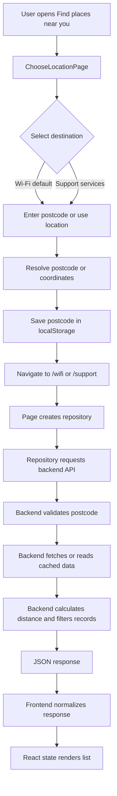
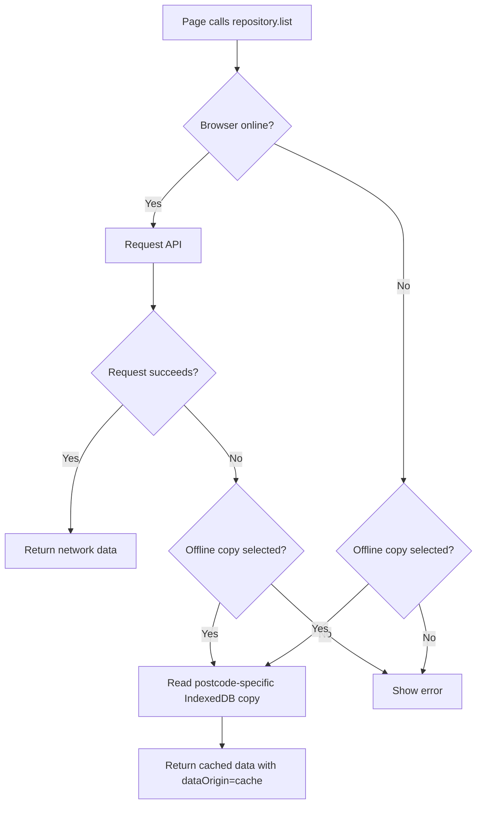

# ShieldAhead Frontend-to-Backend Data Flow

This document explains how user input travels through ShieldAhead, how the frontend calls the backend, how the backend obtains and transforms data, and how the result returns to the user interface.

## 1. Application Shape

ShieldAhead is split into two runtime applications during local development:

```text
Browser
  |
  | Vite frontend
  | http://localhost:5173 (or another Vite port)
  |
  | HTTP requests using VITE_API_BASE_URL
  v
Flask backend
  |
  | http://127.0.0.1:5001 locally
  | /api/wifi
  | /api/charities
  | /api/stats
  v
External data sources and database
```

In the production Docker image, the frontend is built into `frontend/dist`, copied into the backend image, and Flask serves the built single-page application. The production frontend leaves `VITE_API_BASE_URL` empty, so API calls use the same origin:

```text
https://your-live-domain.example/api/wifi?postcode=3064
```

## 2. Main User Flow

The main location flow is:



## 3. Location Input

### Owning file

[ChooseLocationPage.tsx](../frontend/src/features/location/pages/ChooseLocationPage.tsx)

### Inputs shown to the user

The location page contains:

- A radio choice for `Wi-Fi` or `Support services`.
- A postcode or suburb text input.
- A `Search` button.
- A `Use my current location` button.

Wi-Fi is the default destination unless the route was opened with a support destination.

### Manual postcode flow

1. The user types a value into the `Suburb or postcode` input.
2. React stores the input in the component's `query` state.
3. The form submit handler calls `parseManualLocationQuery(query)`.
4. A four-digit postcode is accepted directly.
5. A suburb query is resolved by `resolvePlaceName`.
6. The resolved result contains:

```ts
{
  postcode: string
  label: string
}
```

7. `finish(postcode, label)` calls `saveSearchLocation`.
8. The selected location is stored in localStorage under `shieldahead.search-location.v1`.
9. The page navigates to:

```text
/wifi
```

or:

```text
/support
```

10. Router state also carries the new postcode:

```ts
{
  searchPostcode: postcode,
  searchUpdatedAt: Date.now()
}
```

### Current-location flow

1. The browser supplies latitude and longitude through the Geolocation API.
2. `resolveCurrentCoordinates(latitude, longitude)` calls the Nominatim reverse-geocoding service.
3. The returned suburb/postcode is converted into the same `{ postcode, label }` shape.
4. The same `finish` function saves the postcode and navigates to the selected destination.

### Location errors

The location page catches `LocationResolveError` and shows a user-facing error. It does not call the application backend for the initial suburb/postcode resolution; that resolution is handled by the frontend location helper.

## 4. Browser Storage

### Location storage

[searchLocationStorage.ts](../frontend/src/storage/searchLocationStorage.ts)

The active search location is stored locally. The stored value contains:

```json
{
  "postcode": "3064",
  "label": "Craigieburn 3064",
  "selectedAt": "2026-09-10T00:00:00.000Z"
}
```

The postcode is not stored on the server as a household profile. The backend receives it only as a request parameter when data is requested.

### Offline dataset storage

[offlineDatasetStore.ts](../frontend/src/data/offline/offlineDatasetStore.ts)

When the user chooses a dataset for offline use, the downloaded result is stored in IndexedDB using a key based on:

```text
wifi:3064
support:3064
```

This prevents a saved Wi-Fi result for one postcode from being used for another postcode.

## 5. Frontend Routing

[AppRouter.tsx](../frontend/src/app/AppRouter.tsx) defines the main routes:

```text
/location       Choose a search area
/wifi           Wi-Fi list
/wifi/:id       Wi-Fi detail
/support        Support services list
/support/:id    Support service detail
```

`RequireSearchLocation` prevents `/wifi` and `/support` from loading without a saved postcode. If no postcode exists, the user is redirected to `/location`.

## 6. Wi-Fi Request Flow

### Frontend entry point

[WifiListPage.tsx](../frontend/src/features/wifi/pages/WifiListPage.tsx)

The page obtains the active postcode, creates a Wi-Fi repository, and passes the repository's `list` method into `useRepositoryData`.

```text
WifiListPage
  -> getWifiRepository(postcode)
  -> createApiWifiRepository(...)
  -> repository.list()
  -> GET /api/wifi?postcode=3064
```

### Repository

[wifiRepository.ts](../frontend/src/data/wifiRepository.ts)

The Wi-Fi repository combines:

- The online API repository.
- The offline-aware repository.
- The offline preference check.

### API adapter

[apiWifiRepository.ts](../frontend/src/data/api/apiWifiRepository.ts)

The adapter:

1. Builds the URL with `resolveApiUrl`.
2. Adds the selected postcode as a query parameter.
3. Sends an HTTP `GET` request.
4. Uses an abort timeout to prevent requests hanging forever.
5. Checks the HTTP response status.
6. Parses and validates the JSON response with `normalizeWifiDataset`.
7. Returns a typed `DatasetResult<WifiLocation>`.

Example request:

```http
GET http://127.0.0.1:5001/api/wifi?postcode=3064
Accept: application/json
```

### Wi-Fi backend route

[wifi_routes.py](../backend/routes/wifi_routes.py)

The backend route performs these steps:

1. Reads `request.args["postcode"]`.
2. Rejects a missing postcode with HTTP `400`.
3. Rejects a non-Victorian postcode with HTTP `400`.
4. Converts the postcode to coordinates using `postcode_to_coords`.
5. Loads the shared Wi-Fi source cache or database cache.
6. Fetches VicFreeWiFi data when the cache is stale.
7. Fetches Vicmap public-space data when the cache is stale.
8. Combines the source records.
9. Copies records for the current request so distance values are not shared between concurrent requests.
10. Calculates distance from the requested postcode.
11. Sorts by distance.
12. Keeps records inside the configured search radius.
13. Returns records and dataset metadata as JSON.

### Wi-Fi data sources

- VicFreeWiFi: confirmed public Wi-Fi records.
- Vicmap Features of Interest: likely public facilities such as libraries and community centres.

A Vicmap record may have coordinates but no street address or suburb. That is why the frontend can open the exact coordinate in OpenStreetMap while still reporting that a street address is not confirmed.

## 7. Support-Service Request Flow

### Frontend entry point

[SupportServicesPage.tsx](../frontend/src/features/support-services/pages/SupportServicesPage.tsx)

```text
SupportServicesPage
  -> getSupportServiceRepository(postcode)
  -> createApiSupportServiceRepository(...)
  -> repository.list()
  -> GET /api/charities?postcode=3064
```

### API adapter

[apiSupportServiceRepository.ts](../frontend/src/data/api/apiSupportServiceRepository.ts)

The adapter:

1. Builds `/api/charities?postcode=...`.
2. Sends the request.
3. Converts HTTP errors into user-facing messages.
4. Parses the JSON response.
5. Normalizes service fields and service types.
6. Returns a typed `DatasetResult<SupportService>`.

### Support backend route

[charities_routes.py](../backend/routes/charities_routes.py)

The backend route:

1. Validates the postcode.
2. Converts the postcode into coordinates.
3. Reverse-geocodes the location to find useful locality names.
4. Checks the per-postcode charity cache.
5. Loads a fresh database cache when available.
6. Otherwise fetches ACNC records.
7. Filters records to relevant Victorian support charities.
8. Converts ACNC rows to the frontend `SupportService` shape.
9. Attaches coordinates where possible.
10. Calculates distance from the requested postcode.
11. Sorts records by distance.
12. Returns service records and metadata.

### ACNC service types

The backend infers `serviceTypes` from ACNC free-text fields. Examples include:

```text
Food relief
Emergency relief
Financial counselling / hardship support
Housing support
Mental health support
Youth services
Community support services
```

The frontend displays these labels and keeps the current filter controls:

```text
All services
Food
Financial
Emergency
```

The filters operate on the already returned `serviceTypes`; changing a filter does not make another backend request.

## 8. Backend Response Shape

Both endpoints return a dataset object with records and metadata.

### Wi-Fi example

```json
{
  "records": [
    {
      "id": "vicmap-20686",
      "name": "MICKLEHAM COMMUNITY CENTRE",
      "address": null,
      "suburb": null,
      "postcode": null,
      "latitude": -37.59,
      "longitude": 144.72,
      "distanceKm": 3.8,
      "openingHours": null,
      "accessConditions": [
        "Facility type: community centre",
        "Free wifi likely but not confirmed — check with staff"
      ],
      "verificationStatus": "likely",
      "dataUpdatedAt": "2026-09-10T00:00:00Z"
    }
  ],
  "metadata": {
    "version": "1.1",
    "generatedAt": "2026-09-10T00:00:00Z",
    "sourceName": "VicFreeWiFi + Vicmap Features of Interest",
    "coverageAreas": ["Regional Victoria"],
    "limitations": [],
    "freshnessStatus": "current"
  }
}
```

### Support example

```json
{
  "records": [
    {
      "id": "acnc-12345678901",
      "name": "Example Community Support",
      "serviceTypes": ["Emergency relief"],
      "address": "81 Example Road, Bendigo VIC 3550",
      "suburb": "Bendigo",
      "postcode": "3550",
      "latitude": -36.75,
      "longitude": 144.28,
      "distanceKm": 1.2,
      "phone": null,
      "website": null,
      "eligibility": null,
      "partnerStatus": "unknown",
      "availabilityStatus": "not-confirmed",
      "dataUpdatedAt": "2026-09-10T00:00:00Z"
    }
  ],
  "metadata": {
    "version": "1.0",
    "sourceName": "ACNC Registered Charities Register",
    "coverageAreas": ["Bendigo", "3550"],
    "limitations": [
      "Eligibility conditions are not published in this open dataset"
    ],
    "freshnessStatus": "current"
  }
}
```

## 9. Response Back to React

[useRepositoryData.ts](../frontend/src/data/useRepositoryData.ts) owns the request state:

```text
isLoading = true
        |
        | request starts
        v
success -> data is stored, error is cleared, isLoading becomes false
failure -> error message is stored, isLoading becomes false
```

The page then renders based on the result:

- Loading state while the request is running.
- Error state with a retry button when the request fails.
- Empty state when no records are available.
- Record list when records exist.
- Dataset disclosure showing source and limitations.

React does not directly call `fetch` from the list component. The component calls the repository abstraction, which keeps API, cache, and offline behavior separate from the UI.

## 10. Offline and Cache Behavior

The offline-aware repository follows this decision tree:



Cached results include metadata such as:

```ts
{
  dataOrigin: 'cache',
  cachedAt: string,
  refreshError?: string,
  freshnessStatus: 'stale' | 'current'
}
```

A saved result for postcode `3000` must not be used for postcode `3064` because the IndexedDB key includes both dataset type and postcode.

## 11. Map Link Flow for Wi-Fi

Wi-Fi map links are generated in [wifiMapsUrl.ts](../frontend/src/features/wifi/utils/wifiMapsUrl.ts), using [openMapUrl.ts](../frontend/src/shared/utils/openMapUrl.ts).

```text
Wi-Fi record latitude/longitude exists
  -> OpenStreetMap coordinate URL

No coordinates
  -> OpenStreetMap search URL using the available area/address text
```

Coordinate example:

```text
https://www.openstreetmap.org/?mlat=-37.59&mlon=144.72#map=18/-37.59/144.72
```

This provides an exact map point without claiming that the street address or suburb has been independently confirmed.

## 12. Local Development

Open two terminals.

### Backend

```powershell
cd "C:\Users\sushm\Downloads\New_Project_folder\Main-Project\backend"
python -m pip install -r requirements.txt
python app.py
```

Backend URL:

```text
http://127.0.0.1:5001
```

### Frontend

```powershell
cd "C:\Users\sushm\Downloads\New_Project_folder\Main-Project\frontend"
npm install
npm run dev
```

Open the Vite URL printed in the terminal, commonly:

```text
http://localhost:5173
```

The local frontend configuration is in [frontend/.env](../frontend/.env):

```env
VITE_API_BASE_URL=http://127.0.0.1:5001
```

## 13. Troubleshooting Checklist

### The page shows an old postcode

1. Confirm the browser URL is the current Vite server URL.
2. Refresh the page.
3. Check the browser network request and confirm it contains the expected query:

```text
/api/wifi?postcode=3064
/api/charities?postcode=3064
```

4. Stop old Vite servers if multiple ports are running.
5. Restart the backend after backend route changes.

### The request is aborted

A slow cold start or external data request can exceed the frontend timeout. Check:

- Backend process is running.
- `VITE_API_BASE_URL` points to the correct backend.
- The backend endpoint responds directly in a browser or PowerShell.
- The deployed frontend was rebuilt after source changes.

### A Wi-Fi result has no suburb or address

This can be expected for Vicmap-derived records. If latitude and longitude exist, the exact coordinate is still available through OpenStreetMap.

### A support filter returns no results

Filters operate on inferred `serviceTypes`. The filter does not search the ACNC again. Check the response's `serviceTypes` values and the metadata limitation explaining that service types are inferred from keywords.

## 14. Important Boundaries

- Household profile data stays on the device.
- The backend receives the postcode for location-based data requests.
- Wi-Fi and support services use separate repositories and backend routes.
- Support-service filters are frontend-only after data is loaded.
- Offline data is stored per dataset type and postcode.
- Wi-Fi OpenStreetMap links use record coordinates when available.
- External data source limitations are returned in `metadata.limitations` and exposed through the UI.

## 15. Detailed Python Execution Trace

This section follows one request at interpreter level. Python does not run the
whole backend file again for every browser request. It imports the modules once
when the process starts, creates the Flask application, and then repeatedly
executes the matching route function for each HTTP request.

### Backend startup

When `python app.py` runs:

1. The Python interpreter loads `backend/app.py`.
2. `app.py` imports the Flask application object from `extensions.py`.
3. `extensions.py` creates the Flask app, enables CORS, and configures the rate limiter.
4. `app.py` imports `init_db` from `db.py`.
5. `db.py` reads `DATABASE_URL` from the process environment or `backend/.env`.
6. SQLAlchemy creates a PostgreSQL engine when `DATABASE_URL` exists.
7. `init_db()` executes the `CREATE TABLE IF NOT EXISTS` statements.
8. Startup refresh logic may refresh persistent data according to its freshness rules.
9. Flask registers the Wi-Fi, charities, stats, refresh, SPA, and directions blueprints.
10. `app.run(...)` starts the development HTTP server on port `5001`.

The important point is that table creation happens before the first API request.
If `DATABASE_URL` is absent, `_engine` is `None`, database operations become
no-ops, and the process uses in-memory caches only.

### What happens when `/api/wifi` is requested

Example browser request:

```http
GET /api/wifi?postcode=3064&_refresh=1730000000000
```

The execution sequence is:

1. Flask matches `/api/wifi` to `get_wifi()` in `backend/routes/wifi_routes.py`.
2. The limiter checks the client request rate.
3. `request.args.get("postcode", "")` reads the query-string value.
4. `.strip()` removes accidental surrounding spaces.
5. `is_valid_vic_postcode()` checks the `3xxx` format.
6. `postcode_to_coords()` checks the postcode coordinate cache.
7. If absent, Python calls Zippopotam and then Nominatim as a fallback.
8. The route checks the in-memory Wi-Fi cache.
9. If memory is stale, it checks Neon/PostgreSQL `cache_meta`.
10. If persistent data is fresh, `load_wifi_records_from_db()` reads `wifi_locations`.
11. If no usable cache exists, `fetch_wifi_csv()` calls the VicFreeWiFi source.
12. `csv.DictReader` converts the CSV response into Python dictionaries.
13. `csv_to_wifi_locations()` filters active rows and converts field names into the application contract.
14. `fetch_public_spaces()` calls the Vicmap ArcGIS endpoint.
15. `public_spaces_to_wifi_locations()` converts facility features into likely Wi-Fi records.
16. The records are combined and saved to the in-memory cache and Neon.
17. The route copies records so one postcode request cannot mutate another request's distance values.
18. `haversine_km()` calculates distance from the requested postcode to every record with coordinates.
19. Records are sorted by distance and filtered to `SEARCH_RADIUS_KM`.
20. Python builds a dictionary containing `records` and `metadata`.
21. Flask's `jsonify()` serializes that Python dictionary to JSON bytes.
22. Gunicorn or Flask writes the HTTP status, headers, and JSON body to the browser.

### What happens when `/api/charities` is requested

Example:

```http
GET /api/charities?postcode=3064&_refresh=1730000000000
```

The execution sequence is:

1. Flask matches the route to `get_charities()` in `backend/routes/charities_routes.py`.
2. The postcode is validated and logged in `postcode_requests` asynchronously.
3. `postcode_to_coords()` obtains the requested area's coordinates.
4. `reverse_geocode_locality()` obtains nearby suburb/place names for ACNC matching.
5. The route checks the per-postcode in-memory charity cache.
6. If needed, it checks `cache_meta` and `charities` in Neon/PostgreSQL.
7. If no usable stored data exists, `acnc_service.fetch_charities_for_region()` queries ACNC.
8. Records are filtered to Victorian and relevant support organisations.
9. `charity_to_support_service()` maps ACNC field names to the frontend contract.
10. `geocode_charities()` attempts address-level Nominatim coordinates.
11. `attach_charity_coordinates()` uses a postcode centroid only when address geocoding fails.
12. The records and freshness metadata are saved to cache and Neon.
13. Distances are calculated from the requested postcode.
14. Results are sorted and returned as JSON.

Some charities can still share a point when they have a PO Box, incomplete
address, or an address Nominatim cannot resolve. Those records are intentionally
placed at the postcode centroid as an approximate fallback.

## 16. Exact Frontend Return Path

After Flask returns JSON, the browser-side sequence is:

```text
fetch()
  -> Response.ok check
  -> response.json()
  -> normalizeWifiDataset() or normalizeSupportServiceDataset()
  -> repository.list() resolves
  -> useRepositoryData().then()
  -> setData(result)
  -> React re-render
  -> sorting/filtering/map adapters
  -> visible HTML and map markers
```

### Normalization

The normalizer is a contract boundary. It prevents malformed external values
from reaching components:

- Required strings are rejected if missing.
- Nullable strings become `undefined`.
- Nullable numbers become `undefined` unless finite.
- Missing arrays become empty arrays.
- Unknown status values are removed or converted to conservative defaults.

This means a backend response is not rendered blindly. It must first pass the
frontend's expected data contract.

### Rendering the Wi-Fi list

`WifiListPage.tsx` receives `data.records` and calls
`selectWifiLocationsForList()`. Each record renders its name, verification
badge, area/address text, distance, opening hours, detail action, and map action.

### Rendering support services

`SupportServicesPage.tsx` sorts the returned services, applies the selected
frontend-only filter, and renders service cards. Changing `Food`, `Financial`,
or `Emergency` filters does not call Python again; it filters the already loaded
array in React.

### Rendering maps

The map adapter removes records without valid latitude/longitude values. Valid
records become `MapRecord` objects, then MapLibre creates markers. Markers with
identical coordinates are grouped intentionally and show a picker so the user
can choose among services sharing an approximate point.

## 17. Database Read/Write Timeline

For a fresh request with local PostgreSQL or Neon:

```text
Browser sends postcode
  -> Flask route
  -> SELECT cache_meta
  -> SELECT wifi_locations or charities
  -> If data is fresh: return stored records
  -> If data is missing/stale: call external provider
  -> INSERT/UPDATE records
  -> UPDATE cache_meta
  -> return response
```

The application code is unchanged between local PostgreSQL, Neon PostgreSQL,
and deployment. Only the existing `DATABASE_URL` connection string selects
where persistence occurs.

Useful inspection queries:

```sql
SELECT count(*) FROM wifi_locations;
SELECT count(*) FROM charities;
SELECT postcode, endpoint, requested_at
FROM postcode_requests
ORDER BY requested_at DESC
LIMIT 20;
SELECT key, timestamp, freshness_status FROM cache_meta;
```

## 18. Where to Debug Each Stage

| Stage | File to inspect | What to check |
| --- | --- | --- |
| User input | `ChooseLocationPage.tsx` | `query`, destination, submit handlers |
| Location resolution | `resolveSearchLocation.ts` | Parsed postcode and resolved label |
| Saved postcode | `searchLocationStorage.ts` | LocalStorage value |
| Page request | `WifiListPage.tsx` or `SupportServicesPage.tsx` | Active postcode and repository |
| URL construction | `resolveApiUrl.ts` | API origin and query string |
| HTTP adapter | `apiWifiRepository.ts` or `apiSupportServiceRepository.ts` | Fetch, timeout, status, normalization |
| Request state | `useRepositoryData.ts` | Loading, success, error, retry |
| Flask startup | `app.py` and `extensions.py` | Blueprint registration and DB initialization |
| Wi-Fi route | `routes/wifi_routes.py` | Cache, source fetch, distance, radius |
| Charity route | `routes/charities_routes.py` | ACNC filtering and coordinate enrichment |
| Database | `db.py` | Connection, schema, reads, writes |
| Geocoding | `services/geocoding.py` | Postcode/address coordinates and cache |
| Visible map | `shared/map/MapView.tsx` | Marker creation and coordinate grouping |

This is the complete path from a value typed by the user to the final list,
map marker, loading state, or error message visible in the browser.
